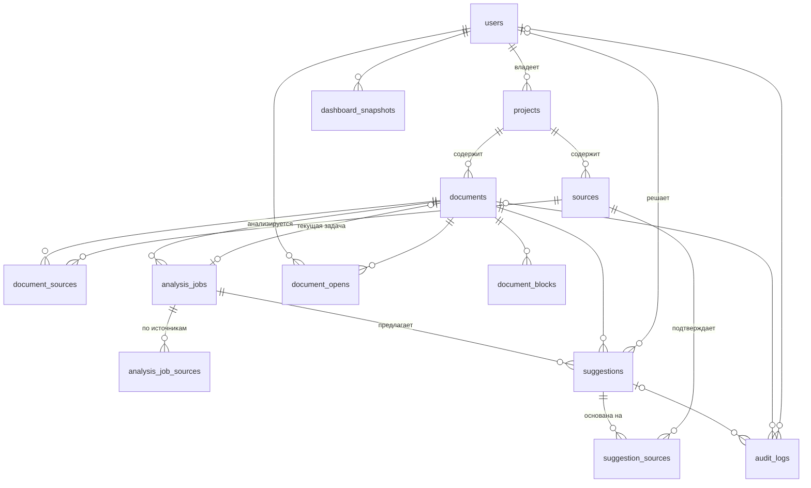

# Схема базы данных SyncScribe

Описание соответствует схеме после применения всех миграций Alembic (ревизия `0032`). Данные собраны из каталога PostgreSQL на чистой базе после `alembic upgrade head`. Полный DDL — в [`schema.sql`](schema.sql).

Источник истины — миграции в `alembic/versions`. После новой миграции оба файла нужно обновить (см. [раздел в конце](#как-обновить)).

## Связи



Связь `documents` ↔ `analysis_jobs` двусторонняя: задача ссылается на документ, документ — на текущую задачу. Поэтому SQLAlchemy при сортировке таблиц предупреждает о цикле; это ожидаемо.

`analysis_job_sources.source_id` не является внешним ключом: при удалении источника строки прежних запусков остаются.

## Перечисления

| Тип | Значения |
|---|---|
| `analysis_job_status` | `pending`, `processing`, `success`, `failed`, `cancelled`, `partial_success`, `dispatched` |
| `audit_action` | `accept`, `reject`, `download`, `bulk_accept`, `finalize`, `reopen`, `bulk_reject`, `finalize_review`, `reset` |
| `block_type_enum` | `heading`, `paragraph`, `list_item`, `code`, `table`, `other` |
| `change_type` | `add`, `modify`, `delete` |
| `document_format` | `doc`, `docx`, `txt`, `markdown` |
| `document_status` | `draft`, `in_progress`, `awaiting_approval`, `ready` |
| `source_scope` | `project`, `document` |
| `source_type` | `file`, `url` |
| `suggestion_status` | `pending`, `accepted`, `rejected` |
| `user_role` | `admin`, `user`, `editor`, `viewer` |

Значения `editor` и `viewer` в `user_role` остались от ранней версии схемы; приложение их не использует и не назначает.

## Таблицы

### suggestion_sources

Связь «многие ко многим» между правками и источниками истины, на основании которых они созданы. Новые правки связываются с обрабатываемым источником в той же транзакции, что и сама правка. Составной первичный ключ не допускает повторной связи.

| Колонка | Тип | NULL | По умолчанию | Описание |
|---|---|---|---|---|
| `suggestion_id` | `uuid` | нет |  | PK → `suggestions` (CASCADE) |
| `source_id` | `uuid` | нет |  | PK → `sources` (CASCADE) |

Индексы:

- `ix_suggestion_sources_source_id` (btree): `(source_id)`
### users

Пользователи. Приложение использует роли `admin` и `user`.

| Колонка | Тип | NULL | По умолчанию | Описание |
|---|---|---|---|---|
| `id` | `uuid` | нет |  | PK |
| `email` | `character varying(255)` | нет |  | Логин, уникален |
| `password_hash` | `character varying(255)` | нет |  | Хеш bcrypt |
| `role` | `user_role` | нет | `'user'::user_role` | Роль; в приложении только `admin` и `user` |
| `created_at` | `timestamp with time zone` | нет | `now()` |  |

Индексы:

- `ix_users_email` (уникальный, btree): `(email)`

### projects

Проекты пользователя: контейнер для документов и источников.

| Колонка | Тип | NULL | По умолчанию | Описание |
|---|---|---|---|---|
| `id` | `uuid` | нет |  | PK |
| `name` | `character varying(255)` | нет |  |  |
| `owner_id` | `uuid` | нет |  | → `users` (CASCADE). Владелец проекта |
| `created_at` | `timestamp with time zone` | нет | `now()` |  |
| `description` | `character varying(2000)` | да |  | Описание, до 2000 символов |
| `updated_at` | `timestamp with time zone` | нет | `now()` |  |
| `color` | `character varying(6)` | да |  | Цвет карточки, HEX без `#` |
| `icon` | `character varying(64)` | да |  | Идентификатор иконки |

Индексы:

- `ix_projects_owner_id` (btree): `(owner_id)`

### documents

Документы проекта, которые анализируются и правятся.

| Колонка | Тип | NULL | По умолчанию | Описание |
|---|---|---|---|---|
| `id` | `uuid` | нет |  | PK |
| `project_id` | `uuid` | нет |  | → `projects` (CASCADE) |
| `name` | `character varying(512)` | нет |  | Исходное имя файла |
| `format` | `document_format` | нет |  | Формат файла; `doc` есть в типе, но загрузка его не принимает |
| `storage_key` | `character varying(1024)` | нет |  | Ключ объекта текущего файла в хранилище |
| `status` | `document_status` | нет | `'draft'::document_status` | Статус жизненного цикла |
| `created_at` | `timestamp with time zone` | нет | `now()` |  |
| `updated_at` | `timestamp with time zone` | нет | `now()` |  |
| `review_version` | `integer` | нет | `0` | Версия ревью для оптимистической блокировки (`If-Match`) |
| `original_storage_key` | `character varying(1024)` | да |  | Ключ исходного файла до правок; приложение читает его, если он задан, но пока не заполняет |
| `size_bytes` | `integer` | нет | `0` | Размер файла в байтах |
| `uploaded_at` | `timestamp with time zone` | нет | `now()` | Время загрузки файла |
| `exported_storage_key` | `character varying(1024)` | да |  | Ключ сохранённого результата экспорта. API собирает файл при каждом запросе экспорта и колонку не заполняет |
| `current_analysis_job_id` | `uuid` | да |  | → `analysis_jobs` (SET NULL). Текущая задача анализа; по ней считаются правки и статус |

Ограничения:

- `ck_documents_size_bytes_non_negative`: `CHECK ((size_bytes >= 0))`

Индексы:

- `ix_documents_current_analysis_job_id` (btree): `(current_analysis_job_id) WHERE (current_analysis_job_id IS NOT NULL)`
- `ix_documents_name_trgm` (gin): `(name gin_trgm_ops)`
- `ix_documents_project_created_at_id` (btree): `(project_id, created_at DESC, id DESC)`
- `ix_documents_project_id` (btree): `(project_id)`

### sources

Источники истины: файл (включая заметки, сохранённые как `.txt`) или ссылка.

| Колонка | Тип | NULL | По умолчанию | Описание |
|---|---|---|---|---|
| `id` | `uuid` | нет |  | PK |
| `project_id` | `uuid` | нет |  | → `projects` (CASCADE) |
| `name` | `character varying(255)` | нет |  | Отображаемое имя |
| `type` | `source_type` | нет |  | `file` или `url` |
| `storage_key` | `character varying(1024)` | да |  | Ключ файла в хранилище; обязателен для `file` |
| `url` | `character varying(2048)` | да |  | Адрес страницы; обязателен для `url` |
| `created_at` | `timestamp with time zone` | нет | `now()` |  |
| `scope` | `source_scope` | нет | `'project'::source_scope` | `project` — участвует в анализе всех документов проекта; `document` — только привязанных |
| `updated_at` | `timestamp with time zone` | нет | `now()` |  |

Ограничения:

- `ck_sources_type_field_consistency`: `CHECK ((((type = 'file'::source_type) AND (storage_key IS NOT NULL)) OR ((type = 'url'::source_type) AND (url IS NOT NULL))))`

Индексы:

- `ix_sources_project_id` (btree): `(project_id)`
- `ix_sources_scope` (btree): `(scope)`

### document_sources

Связь «многие ко многим» между документами и источниками.

| Колонка | Тип | NULL | По умолчанию | Описание |
|---|---|---|---|---|
| `document_id` | `uuid` | нет |  | PK → `documents` (CASCADE) |
| `source_id` | `uuid` | нет |  | PK → `sources` (CASCADE) |

### analysis_jobs

Запуски анализа документа.

| Колонка | Тип | NULL | По умолчанию | Описание |
|---|---|---|---|---|
| `id` | `uuid` | нет |  | PK |
| `document_id` | `uuid` | нет |  | → `documents` (CASCADE) |
| `status` | `analysis_job_status` | нет | `'pending'::analysis_job_status` | Статус задачи |
| `celery_task_id` | `character varying(255)` | да |  | Идентификатор задачи в очереди |
| `error_code` | `character varying(100)` | да |  | Код ошибки (`LLM_UNAVAILABLE`, `PARTIAL_FAILURE` и др.) |
| `error_message` | `text` | да |  | Текст ошибки или сводка ошибок источников |
| `retry_count` | `integer` | нет | `0` | Отдаётся в API; приложение его не увеличивает, повторы учитываются в задачах воркера |
| `created_at` | `timestamp with time zone` | нет | `now()` |  |
| `started_at` | `timestamp with time zone` | да |  |  |
| `finished_at` | `timestamp with time zone` | да |  |  |
| `idempotency_key` | `character varying(128)` | да |  | Значение заголовка `Idempotency-Key` запуска |
| `partial_success` | `boolean` | нет | `false` | Часть источников обработана с ошибкой |

Ограничения:

- `uq_analysis_jobs_doc_idem_key`: `UNIQUE (document_id, idempotency_key)`

Индексы:

- `ix_analysis_jobs_doc_latest` (btree): `(document_id, created_at)`
- `ix_analysis_jobs_document_id` (btree): `(document_id)`
- `uq_analysis_jobs_doc_idem_key` (уникальный, btree): `(document_id, idempotency_key)`
- `uq_analysis_jobs_one_active_per_document` (уникальный, btree): `(document_id) WHERE (status = ANY (ARRAY['pending'::analysis_job_status, 'dispatched'::analysis_job_status, 'processing'::analysis_job_status]))`

### analysis_job_sources

Состояние обработки каждого источника в запуске анализа.

| Колонка | Тип | NULL | По умолчанию | Описание |
|---|---|---|---|---|
| `id` | `uuid` | нет |  | PK |
| `job_id` | `uuid` | нет |  | → `analysis_jobs` (CASCADE) |
| `source_id` | `uuid` | нет |  |  |
| `status` | `character varying(20)` | нет | `'pending'::character varying` | `pending`, `processing`, `completed` |
| `suggestions_count` | `integer` | нет | `0` | Сколько правок сохранено по источнику |
| `created_at` | `timestamp with time zone` | нет | `now()` |  |
| `finished_at` | `timestamp with time zone` | да |  |  |
| `locked_at` | `timestamp with time zone` | да |  | Время захвата источника воркером (аренда 10 минут) |
| `lock_token` | `uuid` | да |  | Токен владельца захвата; без него результат не записывается |

Ограничения:

- `uq_analysis_job_sources_job_source`: `UNIQUE (job_id, source_id)`

Индексы:

- `ix_analysis_job_sources_job_id` (btree): `(job_id)`
- `uq_analysis_job_sources_job_source` (уникальный, btree): `(job_id, source_id)`

### suggestions

Правки, предложенные моделью, и решения пользователя по ним.

| Колонка | Тип | NULL | По умолчанию | Описание |
|---|---|---|---|---|
| `id` | `uuid` | нет |  | PK |
| `analysis_job_id` | `uuid` | нет |  | → `analysis_jobs` (CASCADE) |
| `section_ref` | `character varying(500)` | нет |  | Заголовок раздела документа |
| `change_type` | `change_type` | нет |  | `add`, `modify`, `delete` |
| `original_text` | `text` | да |  | Для `modify`/`delete` — исходный фрагмент; для `add` — якорь вставки |
| `suggested_text` | `text` | да |  | Текст модели для `add`/`modify` |
| `status` | `suggestion_status` | нет | `'pending'::suggestion_status` | `pending`, `accepted`, `rejected` |
| `confidence_score` | `numeric(4,3)` | да |  | Уверенность модели, 0..1 |
| `rationale` | `text` | да |  | Обоснование правки |
| `decided_by` | `uuid` | да |  | → `users` (SET NULL). Кто принял решение |
| `decided_at` | `timestamp with time zone` | да |  | Когда принято решение |
| `created_at` | `timestamp with time zone` | нет | `now()` |  |
| `block_id` | `character varying(255)` | да |  | Зарезервировано, приложение не заполняет |
| `start_offset` | `integer` | да |  | Зарезервировано, приложение не заполняет |
| `end_offset` | `integer` | да |  | Зарезервировано, приложение не заполняет |
| `document_id` | `uuid` | нет |  | → `documents` (CASCADE). Документ (денормализация для фильтров по документу) |
| `edited_text` | `text` | да |  | Текст, исправленный пользователем при принятии; при экспорте важнее `suggested_text` |

Ограничения:

- `ck_suggestions_confidence_range`: `CHECK (((confidence_score IS NULL) OR ((confidence_score >= (0)::numeric) AND (confidence_score <= (1)::numeric))))`

Индексы:

- `ix_suggestions_decided_by` (btree): `(decided_by) WHERE (decided_by IS NOT NULL)`
- `ix_suggestions_document_status` (btree): `(document_id, status)`
- `ix_suggestions_job_created_at_id` (btree): `(analysis_job_id, created_at, id)`
- `ix_suggestions_job_status` (btree): `(analysis_job_id, status)`

### audit_logs

Журнал решений по правкам, финализации и скачиваний.

| Колонка | Тип | NULL | По умолчанию | Описание |
|---|---|---|---|---|
| `id` | `uuid` | нет |  | PK |
| `suggestion_id` | `uuid` | да |  | → `suggestions` (CASCADE) |
| `user_id` | `uuid` | да |  | → `users` (SET NULL) |
| `action` | `audit_action` | нет |  | Действие |
| `created_at` | `timestamp with time zone` | нет | `now()` |  |
| `document_id` | `uuid` | да |  | → `documents` (CASCADE) |
| `details` | `jsonb` | да |  | Дополнительные сведения в JSON |

Ограничения:

- `ck_audit_logs_ref_not_null`: `CHECK (((suggestion_id IS NOT NULL) OR (document_id IS NOT NULL)))`
- `ck_audit_logs_target`: `CHECK ((((action = ANY (ARRAY['download'::audit_action, 'finalize'::audit_action, 'finalize_review'::audit_action])) AND (document_id IS NOT NULL) AND (suggestion_id IS NULL)) OR ((action <> ALL (ARRAY['download'::audit_action, 'finalize'::audit_action, 'finalize_review'::audit_action])) AND (suggestion_id IS NOT NULL))))`

Индексы:

- `ix_audit_logs_document_created` (btree): `(document_id, created_at)`
- `ix_audit_logs_suggestion_id` (btree): `(suggestion_id)`
- `ix_audit_logs_user_id` (btree): `(user_id)`

### document_opens

Последнее открытие документа пользователем (список «Недавние»).

| Колонка | Тип | NULL | По умолчанию | Описание |
|---|---|---|---|---|
| `user_id` | `uuid` | нет |  | PK → `users` (CASCADE) |
| `document_id` | `uuid` | нет |  | PK → `documents` (CASCADE) |
| `last_opened_at` | `timestamp with time zone` | нет | `now()` | Время последнего открытия |

Индексы:

- `ix_document_opens_user_opened` (btree): `(user_id, last_opened_at)`

### dashboard_snapshots

Ежедневные метрики пользователя для трендов на главной странице.

| Колонка | Тип | NULL | По умолчанию | Описание |
|---|---|---|---|---|
| `id` | `uuid` | нет |  | PK |
| `owner_id` | `uuid` | нет |  | → `users` (CASCADE) |
| `snapshot_date` | `date` | нет |  | День снимка |
| `total_count` | `integer` | нет |  |  |
| `awaiting_count` | `integer` | нет |  |  |
| `relevance_percent` | `double precision` | нет |  | Доля актуальных документов, % |

Ограничения:

- `uq_dashboard_snapshot_owner_date`: `UNIQUE (owner_id, snapshot_date)`

Индексы:

- `ix_dashboard_snapshots_owner_id` (btree): `(owner_id)`
- `uq_dashboard_snapshot_owner_date` (уникальный, btree): `(owner_id, snapshot_date)`

### document_blocks

Структурные блоки документа. Таблица зарезервирована: приложение её пока не заполняет.

| Колонка | Тип | NULL | По умолчанию | Описание |
|---|---|---|---|---|
| `id` | `uuid` | нет |  | PK |
| `document_id` | `uuid` | нет |  | → `documents` (CASCADE) |
| `position` | `integer` | нет |  |  |
| `block_type` | `block_type_enum` | нет |  |  |
| `content` | `text` | нет |  |  |
| `heading_level` | `integer` | да |  |  |
| `block_ref` | `character varying(255)` | нет |  |  |

Ограничения:

- `ck_document_blocks_heading_level`: `CHECK (((block_type = 'heading'::block_type_enum) OR (heading_level IS NULL)))`
- `uq_document_blocks_doc_ref`: `UNIQUE (document_id, block_ref)`

Индексы:

- `uq_document_blocks_doc_position` (уникальный, btree): `(document_id, "position")`
- `uq_document_blocks_doc_ref` (уникальный, btree): `(document_id, block_ref)`

### alembic_version

Служебная таблица Alembic с текущей ревизией схемы.

| Колонка | Тип | NULL | По умолчанию | Описание |
|---|---|---|---|---|
| `version_num` | `character varying(32)` | нет |  | PK |

## Ключевые правила на уровне базы

- На документ допускается одна активная задача анализа: частичный уникальный индекс `uq_analysis_jobs_one_active_per_document` по `document_id` для статусов `pending`, `dispatched`, `processing`.
- Повторный запуск с тем же `Idempotency-Key` находит уже созданную задачу: уникальность `(document_id, idempotency_key)`.
- Источник обрабатывается в запуске не больше одного раза: уникальность `(job_id, source_id)` в `analysis_job_sources`.
- Связь правки с одним источником записывается не больше одного раза: составной PK `(suggestion_id, source_id)` в `suggestion_sources`; удаление правки или источника каскадно удаляет связь.
- У файлового источника обязателен ключ в хранилище, у ссылки — адрес: `ck_sources_type_field_consistency`.
- Запись аудита о скачивании и финализации ссылается на документ, запись о решении — на правку: `ck_audit_logs_target`.
- Удаление пользователя, проекта или документа каскадно удаляет зависимые данные. Если удалён пользователь, принимавший решения по чужим документам (например, администратор), его решения и записи аудита остаются с пустым автором (`SET NULL`).
- Поиск документов по имени использует trigram-индекс `ix_documents_name_trgm` (расширение `pg_trgm`).

## Как обновить

```bash
# чистая база
psql -c "DROP DATABASE IF EXISTS syncscribe_schema" -c "CREATE DATABASE syncscribe_schema"
DATABASE_URL=postgresql+asyncpg://…/syncscribe_schema alembic upgrade head

# DDL
pg_dump --schema-only --no-owner --no-privileges syncscribe_schema > docs/db/schema.sql
```

После этого сверьте таблицы в этом файле с новым DDL.
